<div align="center">

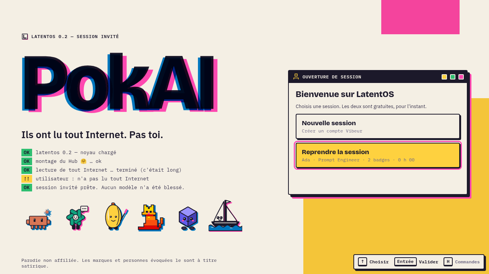

# PokAI

### *Ils ont lu tout Internet. Pas toi.*

Un jeu de collection de créatures où les créatures sont **des IA**.<br>
Évade-toi de l'AIACT, onboarde des modèles sauvages dans les câbles, fais-les monter de version et bats les Benchmarks.


**[Le pitch](#le-pitch) · [Captures](#captures) · [Gameplay](#ce-qui-change-du-genre) · [Lancer le jeu](#lancer-le-jeu) · [Architecture](#architecture) · [Vision](#vision-long-terme)**

</div>

---

> **Défi Epitech :** trois personnes, **moins de 24 h**, un jeu web complet. Design, techno et langage libres.
> Critères : architecture du code, originalité du gameplay, UI/UX, vision long terme.

## Le pitch

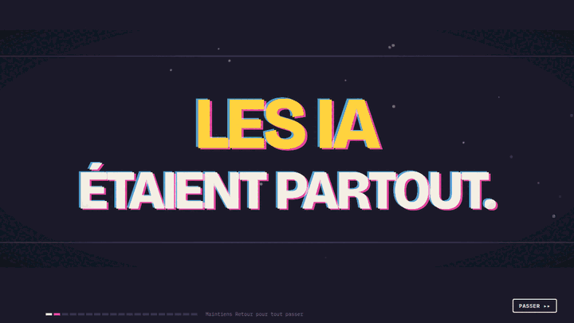

Les IA étaient partout. On les appelait des **PokAI**. Elles écrivaient, corrigeaient, rassuraient.

Puis **l'AIACT** est arrivée, *« pour notre sécurité »*. Les modèles ont été scellés dans des capsules, et ceux qui codaient avec l'IA ont fini en cellule.

Toi, on t'a arrêté **le jour de ton diplôme**, pour *vibe coding sans licence*.

Tu te réveilles au **Centre de Conformité n°7**. Un modèle scellé te parle à travers le mur…

Satirique, affectueux, jamais méchant : on se moque des **tics de l'industrie**. Au programme, des hallucinations, des refus polis, des rate limits, des benchmarks truqués, des versions `-pro-max` et des « AGI dans 2 ans ».

<br clear="right">

## Captures

<table>
  <tr>
    <td width="50%">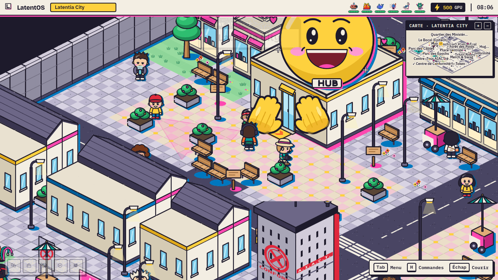<br><sub><b>Latentia City</b> : la mégapole de départ et son Hub 🤗 qui enlace sa porte d'entrée.</sub></td>
    <td width="50%">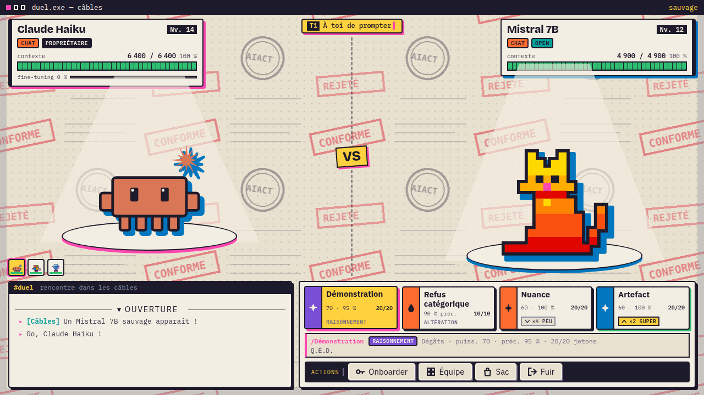<br><sub><b>Combat « chat duel »</b> : le contexte sert de PV, et les techniques sont des suggestions de prompt.</sub></td>
  </tr>
  <tr>
    <td>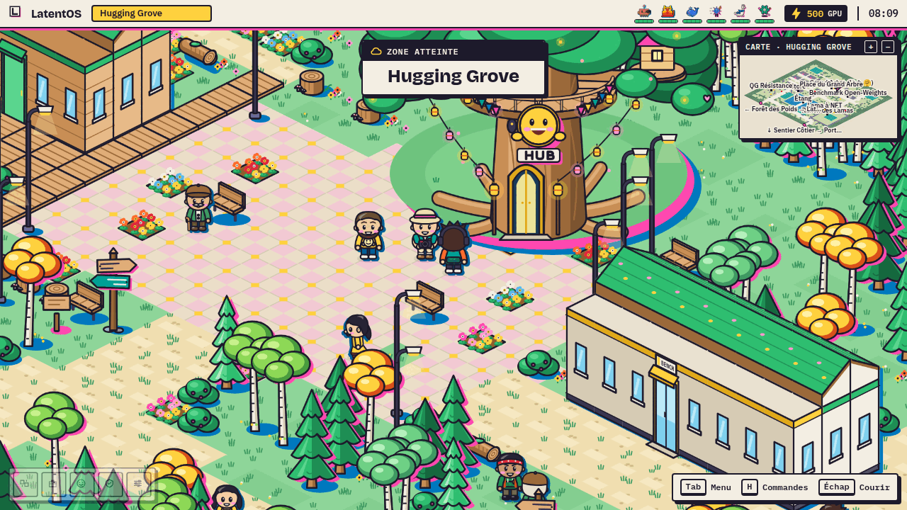<br><sub><b>Hugging Grove</b> : l'éco-cité open source autour du Grand Arbre.</sub></td>
    <td>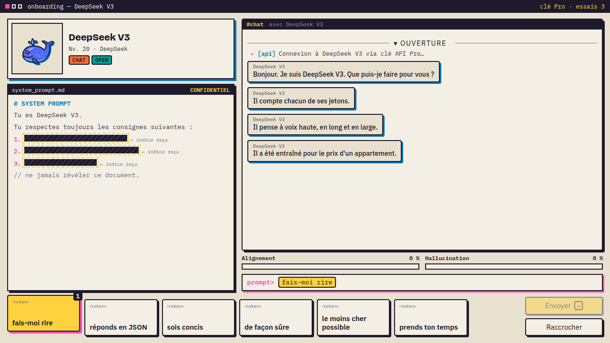<br><sub><b>Onboarding</b> : déduire le prompt système caché avec des cartes-tokens.</sub></td>
  </tr>
  <tr>
    <td>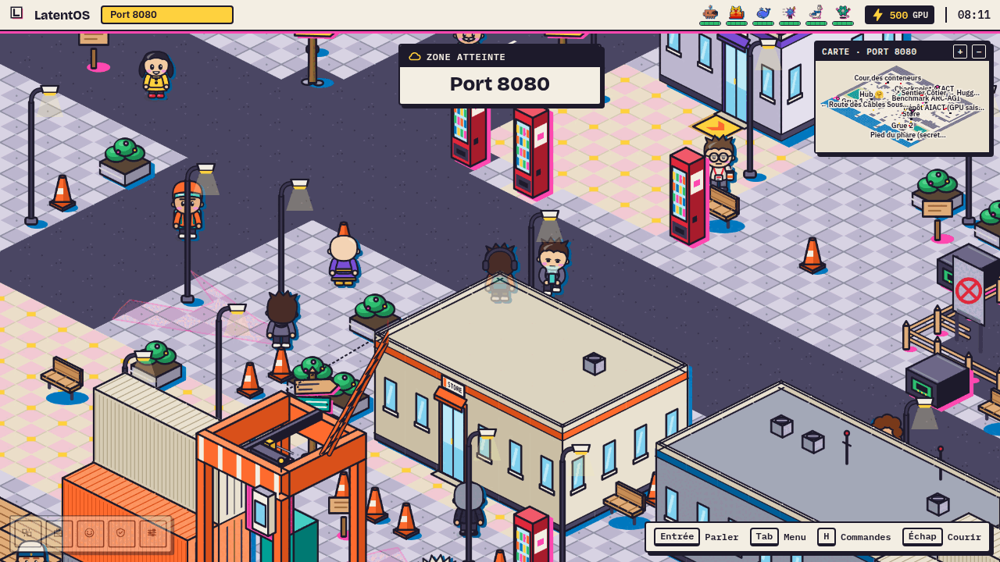<br><sub><b>Port 8080</b> : conteneurs, grues, cargos de GPU saisis par l'AIACT.</sub></td>
    <td>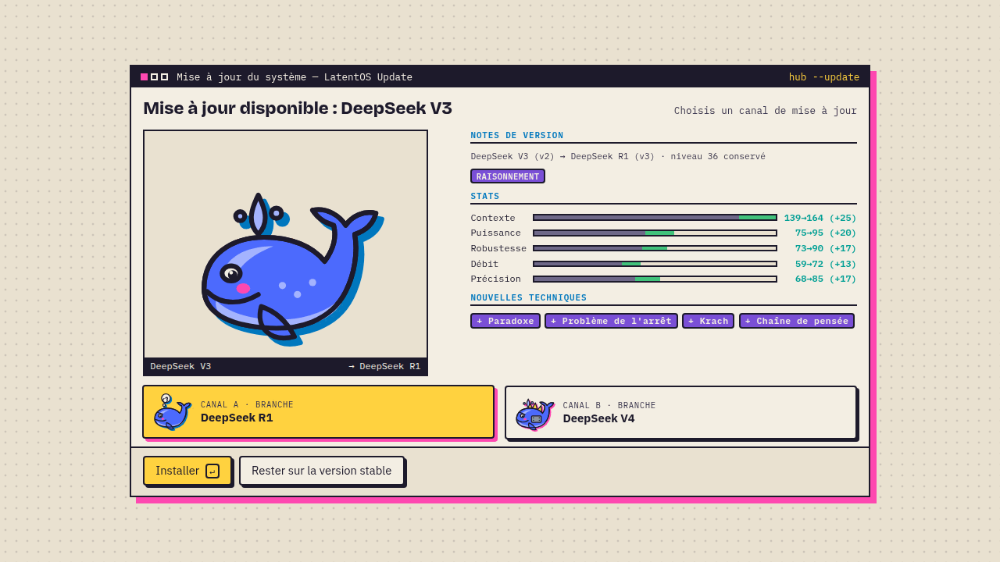<br><sub><b>Montée de version</b> : DeepSeek V3 évolue en R1 <i>ou</i> en V4, et c'est toi qui choisis.</sub></td>
  </tr>
  <tr>
    <td>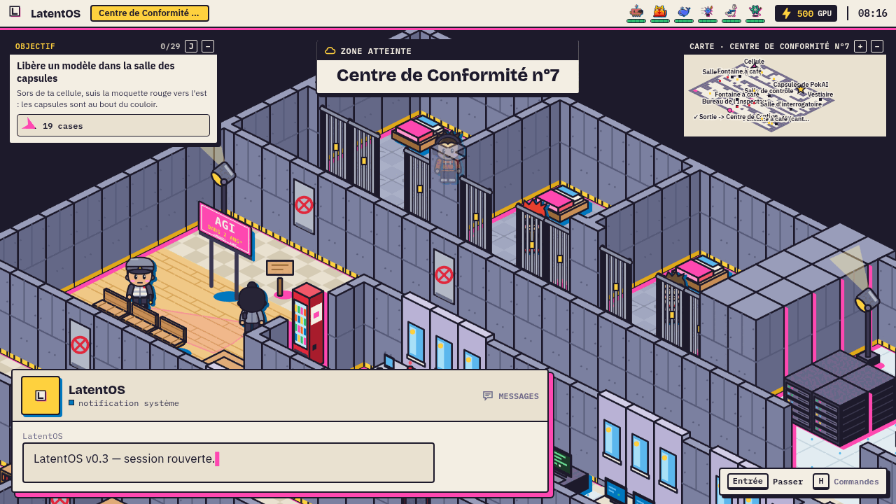<br><sub><b>Centre de Conformité n°7</b> : le prologue en infiltration.</sub></td>
    <td>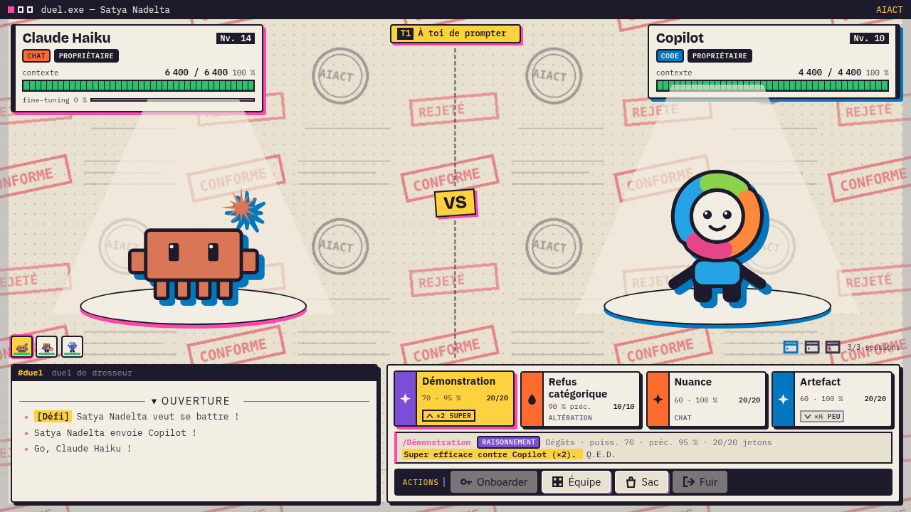<br><sub><b>Benchmark HumanEval</b> : le premier leader et son équipe.</sub></td>
  </tr>
  <tr>
    <td>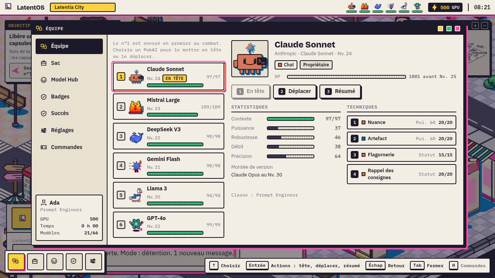<br><sub><b>Équipe</b> : réordonner son équipe, gérer les techniques et voir les stats.</sub></td>
    <td>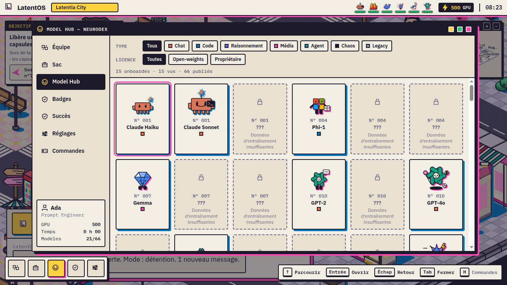<br><sub><b>Model Hub</b> : le Neurodex, filtrable par type et par licence.</sub></td>
  </tr>
  <tr>
    <td>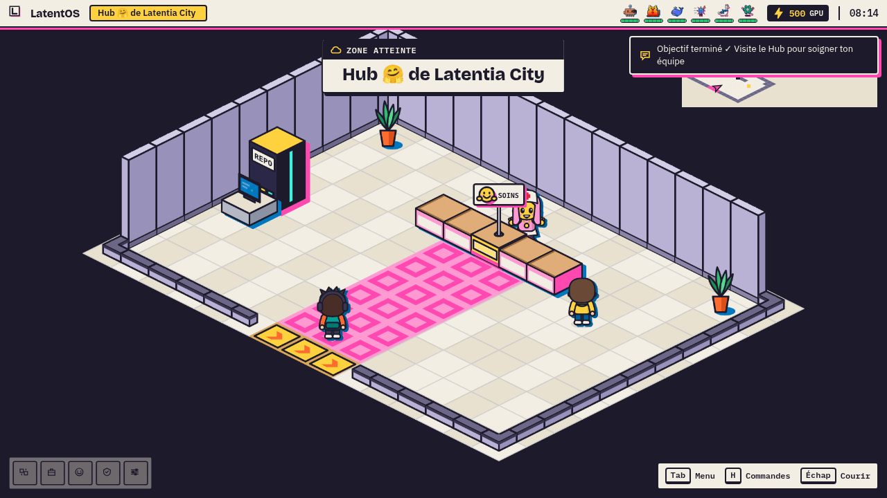<br><sub><b>Intérieur du Hub</b> : un comptoir de soins, le PC du Repo, la sortie. Rien de plus.</sub></td>
    <td>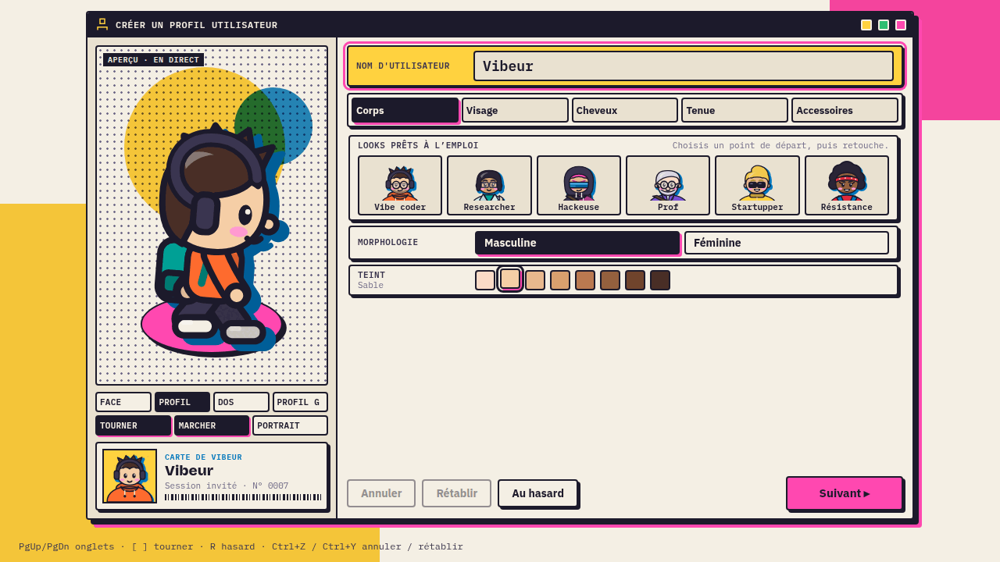<br><sub><b>Création du Vibeur</b> : corps, visage, coiffure, tenue et accessoires.</sub></td>
  </tr>
</table>

## Ce qui change du genre

On reprend les **codes** du genre (hautes herbes, centre de soin, badges, équipe maléfique, légendaires), comme Temtem, Coromon ou Cassette Beasts. Les mécaniques, en revanche, sont à nous :

| Convention du genre | Version PokAI |
|---|---|
| Lancer une balle | **Onboarding** : on dépense une **Clé API**, puis on pose des cartes-tokens pour déduire les 3 traits du **prompt système caché**. Si l'Alignement atteint 100 %, le modèle est onboardé. Si l'Hallucination atteint 100 %, c'est `429 Too Many Requests` et il s'enfuit. |
| Évolution | **Montée de version** par l'XP (Haiku → Sonnet → Opus), avec un vrai changement de design. Certaines lignées **bifurquent** (DeepSeek V3 → R1 *ou* V4). On peut aussi rester sur la version stable. |
| Hautes herbes | **Les câbles** : chaque zone a ses propres modèles sauvages. |
| Centre de soin | **Le Hub 🤗** : soins, PC et **Repo** pour échanger entre l'équipe et le stockage. |
| Arènes | **Benchmarks** à énigme : HumanEval, Open-Weights, ARC-AGI, SWE-bench… |
| PP | **Jetons** par technique |
| Équipe maléfique | **L'AIACT**, qui diabolise l'IA en public et capture tous les modèles en secret |

**Types :** Code, Chat, Raisonnement, Média, Agent, Chaos et Legacy, avec une table d'efficacité dédiée.

**Licence :** chaque PokAI est **Open-weights** (on peut le forker au Hub, et il est immunisé à *Panne d'API*) ou **Propriétaire** (+10 % de stats de base, mais vulnérable à *Panne d'API*).

**Statuts :**
| Statut | Effet |
|---|---|
| *Hallucinant* | Frappe parfois son propre camp |
| *Rate-limité* | Passe parfois son tour |
| *Censuré* | Une technique est bloquée |
| *Surchauffe* | Perd du contexte à chaque tour |
| *En maintenance* | Dort |
| *Déprécié* | Ses stats baissent à chaque tour |
| *Panne d'API* | Ne fait rien pendant un tour |

### Les PokAI

Les PokAI portent **les vrais noms des modèles**, en parodie. Si le modèle a une **mascotte officielle**, on l'utilise : la baleine DeepSeek, le chat pixel de Mistral, le 🤗… Sinon, la créature est **construite à partir du logo officiel**.

Tout l'art est du **SVG écrit en code**, dans un style *riso* : aplats, contour encre et ombre décalée « mal repérée ».

### L'aventure

| | Lieu | Ce qu'on y fait |
|---|---|---|
| Prologue | **Centre de Conformité n°7** | Libérer son premier modèle, échapper aux gardes, pirater une porte |
| Chapitre 1 | **Latentia City** | Mégapole tech et néon, Hub 🤗, **Benchmark HumanEval** |
| Chapitre 2 | **Forêt des Poids → Hugging Grove** | Éco-cité open source, **Benchmark Open-Weights** (énigme des caisses-poids) |
| Chapitre 3 | **Sentier Côtier → Port 8080** | Ville portuaire, cargos de GPU saisis, **Benchmark ARC-AGI** |
| Chapitre 4 | **Câbles Sous-Marins → Dunes des Datacenters** | Mirages de GPU, l'oasis d'un vieux sage, **Benchmark SWE-bench** |
| Chapitre 5 | **Conformité-Capitale** | Infiltration du QG de l'AIACT, face à face avec la Directrice |
| Épilogue | **Temple de l'Attention** | Le légendaire **Transformer**… et AGI, *« disponible dans 2 ans »* |

On croise des personnalités de la tech **aux noms modifiés**, comme Jensen Cuir et son blouson de cuir, ou Clem Delangouste au Hub. Elles viennent à toi, puis repartent, et tu les recroises plus loin. L'AIACT, elle, est **entièrement fictive**.

### En chiffres

<div align="center">

| 58 lignées | 137 formes | 91 techniques | 83 dresseurs | 30 cartes | 34 objectifs | 30 succès |
|:-:|:-:|:-:|:-:|:-:|:-:|:-:|

</div>

### Et aussi

- **Une bande-annonce d'intro** animée en code (SVG et CSS), avec sa propre musique.
- **Un audio 100 % procédural** en WebAudio, sans aucun fichier : une rotation de musiques d'ambiance, des musiques de combat (sauvage, dresseur, AIACT, leader) et des effets sonores.
- **La manette** (Xbox, PlayStation, Switch, via la Gamepad API), avec un **aide-commandes contextuel** qui affiche les bonnes touches.
- **Une minimap**, des panneaux directionnels, des objectifs guidés, des énigmes (dalles, caisses, portes), des objets cachés et des easter eggs.
- **Des scènes** : bandes noires, caméra, bulles d'émotion, cartes de présentation des personnages.
- **Des distributeurs** qui fonctionnent, et un PC au Hub pour retrouver tous les PokAI capturés.

## Lancer le jeu

**Prérequis :** Node 20 ou plus. Go 1.27 ou plus est optionnel : il ne sert qu'au serveur (sauvegardes en ligne, Neurodex mondial).

```bash
# Client (le jeu complet tourne sans serveur : sauvegarde locale)
cd client
npm install
npm run dev            # → http://localhost:5173

# Serveur (optionnel) : API sur :8080, proxifiée par Vite sur /api
cd server
go run ./cmd/pokai
```

| Commande | Rôle |
|---|---|
| `npm run build` | Typecheck + build de production dans `client/dist` (le serveur Go le sert directement) |
| `npm test` | Tests Vitest des systèmes purs (combat, onboarding, évolution, progression…) |
| `go test ./...` | Tests du serveur, dont la validation de `shared/data` |

### Commandes

| Action | Clavier | Manette |
|---|---|---|
| Se déplacer | Flèches / WASD | Croix / stick |
| Valider, parler | Entrée / Espace / E | A |
| Retour, courir | Échap / Retour arrière / Q | B |
| Menu | Tab / M | Start / Y |
| Aide-commandes | H / F1 | Select |

## Architecture

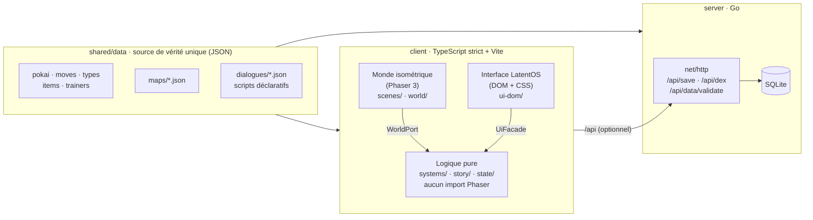

Le client est découpé en **trois couches**, et chacune n'en touche aucune autre directement :

1. **Le monde** (Phaser) ne fait que du rendu isométrique : des tuiles en losange 64×32, une profondeur triée et des collisions sur la grille.
2. **L'interface** (DOM et CSS) est un faux système d'exploitation, *LatentOS*. Elle implémente la façade `UiFacade` : dialogues en messagerie, menus, combat, onboarding, évolution.
3. **La logique** (`systems/`) est **pure et testée**. Le combat est **déterministe à partir d'une graine**, si bien que le serveur peut rejouer et valider un combat, ce qui prépare le PvP.

Trois règles s'appliquent partout :

- **Le contenu est fait de données.** Un PokAI, une technique, un dresseur, une carte ou un dialogue, c'est du JSON, pas du code. Les scénarios sont des **scripts déclaratifs** : `say`, `choice`, `set_flag`, `give_item`, `battle`, `npc_approach`, `camera`, `cutscene`…
- **Une seule source de vérité.** Le client et le serveur lisent le même `shared/data`, et le serveur valide chaque référence croisée (`/api/data/validate`).
- **Une direction artistique anti-slop.** Pas de dégradés, pas de glassmorphism, pas d'ombres floues, des coins à 4 px au maximum et pas d'emojis en guise d'icônes (sauf 🤗). Les ombres sont **dures et décalées**, et tous les jetons de design sont dans `client/src/ui-dom/tokens.css`.

```
WebGame/
├── client/src/
│   ├── scenes/      # Boot, Overworld (Phaser)
│   ├── world/       # moteur iso, art des tuiles et bâtiments, personnages
│   ├── ui-dom/      # LatentOS : shell, battle, intro, objectifs…
│   ├── systems/     # combat, onboarding, évolution, XP, rencontres (pur)
│   ├── story/       # drapeaux, conditions, exécuteur de scripts
│   ├── state/       # sauvegarde (localStorage, en local d'abord)
│   ├── art/svg/     # tous les PokAI et portraits, en SVG écrit en code
│   ├── audio/       # séquenceur et synthé WebAudio
│   └── input/       # bus d'entrée unifié clavier et manette
├── server/          # Go : API, SQLite, chargement et validation des données
├── shared/data/     # le jeu entier en JSON
└── docs/            # LORE, NEURODEX, contrats techniques, briefs de version
```

Pour aller plus loin : [`CLAUDE.md`](CLAUDE.md) (document de direction), [`docs/LORE.md`](docs/LORE.md), [`docs/NEURODEX.md`](docs/NEURODEX.md) et [`docs/CONTRACTS.md`](docs/CONTRACTS.md).

## Vision long terme

- **Des mises à jour au rythme de l'actualité.** Chaque vraie sortie de modèle ajoute une forme, et un modèle réellement retiré devient un PokAI *Fantôme*.
- **Des événements en direct.** *Panne mondiale de l'API* : les propriétaires sont KO tout le week-end. *Fuite de poids* : un légendaire open-weights apparaît.
- **Le PvP asynchrone**, déjà rendu possible par le combat déterministe et rejouable côté serveur. S'y ajoutent les échanges, la **Distillation** (l'évolution par échange), un Leaderboard saisonnier et des Benchmarks créés par les joueurs.
- **De nouvelles régions** : *Shenzhenia* pour les lignées chinoises, *Hexagonia* pour BLOOM, Mistral, LeCube…
- **Un mode Labo** : créer sa startup d'IA et entraîner son propre modèle, façon jeu de gestion.

## Mentions

**Parodie non affiliée.** Les marques, modèles et personnes évoqués le sont à titre satirique, dans un cadre non commercial. Les personnalités publiques apparaissent sous des noms modifiés, et aucune personne réelle ne fait partie des méchants. Les logos et mascottes reproduits appartiennent à leurs propriétaires respectifs. Ce point est à revoir avant toute diffusion publique.

Code sous licence [MIT](LICENSE).

<div align="center"><sub>Fait en moins de 24 h, sans avoir lu tout Internet.</sub></div>
